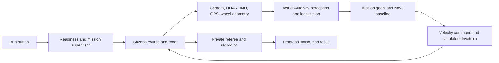

# Full-track AutoNav in Gazebo: implementation plan

Status: proposed implementation, based on repository and rules review on 2026-09-28. This document does not claim that a full-course run has been implemented or tested.

## Target experience

Open the simulator, see the complete course and robot at the start, and press **Run** once. The application checks readiness, enables simulated autonomous operation, drives the entire course using the actual AutoNav ROS 2 stack, crosses the finish, stops, and saves the result. No joystick, RViz goal placement, terminal commands, or manual intermediate goals are needed during a run.

The user selected **the actual ROS 2 stack in Gazebo**. Use ROS 2 Humble and Gazebo Fortress with a pinned, compatible version of the robot and simulator repositories. A default Nav2 algorithm is sufficient; no learning or algorithm competition infrastructure is required for this milestone.

Assumption: "full track" means the complete local `Mock_Course_Asset/Course.blend` asset. Audit its contents before claiming it matches the attached rules. Use the upstream official-style full-loop course as an early integration test, and make the validated Blender course the delivered default. Neither asset should be described as an exact reconstruction of the competition venue without evidence.

## What exists and what is missing

| Component | Reviewed state | Consequence |
|---|---|---|
| Local course | `Course.blend` is a real 9.58 MB asset. Its object properties and dimensions have not been validated. | Inventory and export the actual scene before planning navigation around assumed metadata. |
| Local exporter | `tools/export_course.py` exports GLB and raw metadata; `tools/audit_course_export.py` checks basic transforms, bounds, and meter units. | Add semantic course validation and Gazebo-compatible world generation. A GLB export alone is not a runnable world. |
| Local runtime | No SDF world, robot URDF, ROS package, or ROS launch pipeline was found. The uncommitted Python prototype uses small authored scenarios. | Preserve that work; build the confirmed ROS/Gazebo workflow separately. |
| Robot repository | `KazakhStallion/AutoNav_25-26`, reviewed main revision `00875b391b9ea897681893ec063c99a3d9d32835`, contains the actual perception, Nav2, robot model, and launch configuration. | Reuse those interfaces and nodes with explicit simulation overrides. |
| Active simulator | Robot documentation points to `blobspire/autonav_sim`, reviewed main revision `46b8e9aa953160b2d317fcc811e209fed46a52f4`. It has a Fortress simulator and automated test runner. | Extend the active simulator rather than starting a second ROS simulation engine. |
| Compatibility | Simulator launch/test defaults expect `nav2_params_camera.yaml` or `nav2_params_lidar.yaml`; reviewed robot main instead has `nav2_paramsv2.yaml` and `nav2_params.yaml`. | Pin both revisions and provide an explicit, tested parameter file. Current main branches are not a verified working pair. |
| Existing automation | Test runner uses fixed startup sleeps; alternate course configuration also needs a matching world. | Replace guessed startup delays with readiness checks and generate/pass the world and course configuration together. |
| Localization | Existing simulator bridge supplies Gazebo odometry as `/odom` and `/local_ekf/odom`, with identity `map -> odom`. | Useful for initial bring-up; completing that mode alone does not validate the robot's estimator. |
| This Windows host | Ubuntu and Docker Desktop WSL 2 distributions are installed but were stopped. Docker client exists; its Linux engine was unavailable during review. | First verify Linux version, GUI rendering, dependencies, and GPU availability. ROS/Gazebo execution has not been tested here. |

## Proposed default navigation

Use the existing ROS interfaces with a dedicated `full_track_baseline` configuration:

1. **Perception:** simulated camera for painted lane boundaries and white pothole discs; LiDAR/depth for barrels, other obstacles, and terrain. Reuse current detector outputs where appropriate. A painted pothole must be detectable visually, not converted into an invisible collision wall.
2. **Localization:** simulated wheel odometry and IMU feed the robot estimator; GPS supports the existing geographic waypoint handling. Audit whether the stack requires online SLAM for its operational frame, and start it from empty state when used. Assign exactly one publisher to each TF transform.
3. **Mission:** follow the observed lane corridor, switch to the supplied GPS waypoint sequence through No Man's Land and the ramp approaches, then reacquire lanes and continue to the finish. Lane goals come from sensed geometry; the four permitted GPS targets do not encode the entire lap.
4. **Planning:** start with Nav2 Smac State Lattice planning over an observed costmap and the existing MPPI controller. Configure the real robot footprint, acceleration, reverse capability, clearance, and simulation time. Suggested initial cruise is 0.7 m/s, reduced for curvature and clearance; measured performance determines final tuning.
5. **Recovery:** replan, perform bounded collision-checked backup/turn maneuvers, and stop with an explanation if progress cannot resume. Never advance a mission checkpoint merely because a recovery timed out.

This is a proposed coherent baseline, not a description of the current YAML: reviewed robot main uses a custom `LocalThenStraightPlanner` with a short local horizon and unchecked far segment. Its behavior tree also does not currently invoke the documented `PathFootprintSafe` check. Explicitly configure path and swept-footprint validation; loading defaults is not enough.

The camera detector currently depends on CUDA. Verify it early. If the target Linux/GPU setup cannot run it, implement a CPU image-processing adapter preserving the line-detection interface and test it against rendered images. No dedicated pothole interface was verified: add or validate a camera-derived pothole exclusion representation in the costmap, including the whole hazardous disc. An oracle costmap or privileged full-course route can diagnose faults, but cannot pass the final sensor-driven acceptance test.

### Existing interfaces to preserve

| Purpose | Reviewed upstream interface |
|---|---|
| Drive | `/cmd_vel` (`Twist`) through the dynamics adapter to `/cmd_vel_gazebo` and the Shogi DiffDrive plugin. |
| LiDAR/GPS | `/cloud_all_fields_fullframe` (`PointCloud2`), `/scan_fullframe` (`LaserScan`), `/gps_fix` (`NavSatFix`). |
| Camera | ZED-compatible RGB/depth/calibration topics; verify exact namespaces and optical frames in the pinned launch. |
| Perception | Camera `/line_points`, RSSI `/lidar_line_points`, PCA `/scan_pca_filtered_points` and downstream marking/clearing scans. Add/verify pothole handling explicitly. |
| Localization/map | `/local_ekf/odom`, `/map_padded`, and `map -> odom -> base_link -> nav_center/sensors`. |
| Mission | `/navigate_to_waypoint` (`autonav_interfaces/action/NavigateToWaypoint`). GPS uses `frame_id=wgs84`, **x=longitude, y=latitude**. Local goals use `map`; do not rely on the stale `odom` wording in the action definition. |
| Results | `/igvc_sim/score`, `/igvc_sim/fail`, action results, and rosbag records. |

The existing mission runner submits sparse goals and waits for navigation results. Extend it with lane-progress behavior where needed; sparse GPS targets alone do not guarantee navigation around unseen winding corridors.

## Delivery stages and acceptance gates

### 1. Establish a compatible Linux simulation workspace

- Prefer Ubuntu 22.04 in WSL 2 with a visible Gazebo window on Windows; verify the installed Ubuntu release first. Keep build/install files in the Linux filesystem. Use a pinned Linux container if needed for the existing stack dependencies.
- Record full commit SHAs, submodules, ROS/Gazebo versions, dependencies, and the selected Nav2 profile in a workspace manifest. Make no changes to existing uncommitted Python work.
- Build the existing robot model, simulator package, required planners/controllers, and detectors. Resolve the mismatched YAML paths explicitly and verify referenced motion primitives and behavior-tree plugins exist.
- Validate simulation-time configuration on every node. In particular, passing `use_sim_time` into the existing detection launch is insufficient unless that launch declares and applies it.
- Run the existing compact course as a smoke test with visible Gazebo. A clearly labeled simulator-pose mode is acceptable for this gate only.

**Gate:** the robot responds through the real Nav2 command path, sensors and TF update, and all required nodes run with simulation time. Preserve logs of failures rather than hiding them behind fixed delays.

### 2. Bring the complete track into Gazebo

- Open `Course.blend`, render an overview, and inventory actual object names, transforms, dimensions, materials, and custom properties. Check meter scale and whether the course includes all required sections.
- Reuse the simulator's `igvc_competition_sim/autoresearch/tools/export_blender_course.py`, `igvc_competition_sim/generate_world.py`, and `autoresearch/lib/validate_course.py` before writing replacements. Its exporter expects object `type` values such as `cone`, `ground`, `line`, `ramp`, `waypoint`, and `start`, plus `waypoint_order`; map the actual asset schema explicitly and extend it for missing potholes/boundaries/finish semantics.
- Define a versioned course schema: source asset hash, world/GPS origin, start pose/direction, lane and internal-boundary geometry, obstacle footprints, ramp surface, pothole discs, No Man's Land region, four permitted GPS targets, ordered referee checkpoints, and finish gate.
- Separate public mission data from private evaluation geometry. Course centerlines, ground-truth pose, hidden obstacles, and scoring checkpoints must not become navigation inputs.
- Generate supported visual meshes, efficient collision shapes, an SDF world, and matching mission/referee configuration from one source. Retain camera-visible white markings without physically blocking the wheels. Verify ramp collision geometry is continuous.
- Validate track dimensions, minimum passage width, robot spawn clearance, ramp grade, lane continuity, and a complete traversable route. List departures from the 2026 rules if the mock asset differs.
- First exercise the upstream `official_full_loop.yaml` with its matching generated world; then exercise the exported Blender course. Do not combine one course's YAML with another course's SDF.

**Gate:** the full course is visible and physically traversable, and sensors observe its lines, obstacles, potholes, and ramp correctly. Course and world hashes match in the run manifest.

### 3. Close the sensor-to-motion loop across the whole mission

- Audit and adapt camera image/calibration, point cloud/scan, IMU, wheel odometry, GPS, TF, velocity, and mission-action interfaces to the actual robot nodes. Preserve message types, frame IDs, units, and timestamps.
- Replace simulator-provided `/local_ekf/odom` and fixed localization transforms with the real estimator path. Ground-truth pose remains within physics, sensor generation, the referee, and the viewer; it is inaccessible to navigation/localization nodes.
- Disable the simulator harness's competing `/map_padded` output as well as its filtered-odometry/TF outputs. Use the robot's online mapping/map-padding path where required. Confirm `/map_padded` contains only information derived from this run's observations.
- Make lane following generate reachable local goals; handle dashed lines and brief detection gaps. At forks/ambiguous gaps, use mission direction and observed corridor continuity instead of hidden geometry.
- Implement the new mission state machine connecting GPS entry, ramp approach/traversal, exit, lane reacquisition, and finish. The existing waypoint sequencer does not already provide these lane-transition behaviors. Use configurable waypoint tolerance; the attachment does not unambiguously define an arrival radius.
- Test GPS dropout, ramp attitude changes, stale sensor data, and recovery without continuing on expired commands. Track progress by legal course gates so a short cut or repeated loops cannot masquerade as completion.

**Gate:** the robot completes the full course under the default algorithm with no manual goals, teleoperation, prerecorded trajectory, or privileged map input. All major sensor/localization components run together.

### 4. Deliver the Run-button application

Provide a dedicated full-course launcher backed by the ROS supervisor; it may share presentation with the current application, but must manage a real ROS/Gazebo session.

- Default selections: validated full track, baseline algorithm, repeatable seed, visible Gazebo. Show the entire track and robot before driving.
- Lifecycle: `Idle -> Starting -> Ready -> Running -> Completed / Failed / Stopped`. A Run click can queue startup and automatically enter Running after readiness; no second autonomous-enable action is needed.
- Readiness checks: matching world/config, robot spawned, simulation clock advancing, required sensors fresh, TF complete, Nav2 lifecycle nodes active, mission action server available, and simulated drivetrain ready.
- Enable AUTO and submit the mission once, only after readiness. Treat Gazebo's physics play control separately from the application's autonomous Run action.
- Replace the harness's continuous `/autonomous_mode=true` publication with supervisor-controlled mode. That topic alone is not a motion interlock: add a supervisor-owned command gate before the dynamics adapter, with zero commands and command expiry enforced on Stop/failure.
- Show current section, distance/progress, elapsed simulation time, measured speed, sensor health, planned path, and failure reason. Keep camera and estimated costmap views alongside the course view.
- Add Pause/Resume, Stop, and Reset. Pause freezes simulated time coherently; Stop cancels navigation and inhibits motion; Reset clears localization, costmaps, commands, mission state, and referee history. A simulator restart is an acceptable reliable reset implementation initially.
- Save the manifest, rosbag, mission events, trajectory, rule events, and final result. A watchdog stops motion on lost control or failed required nodes. A wall-time startup/watchdog deadline also handles a stalled simulation clock.

**Gate:** from the installed desktop shortcut, one Run click produces a complete autonomous attempt and clear result. Three consecutive reset-and-rerun attempts leave no stale goals or duplicate TF publishers.

### 5. Verify repeatability and rules-based behavior

The following thresholds come from the supplied PDF's AutoNav sections, printed pages 5-13. They are simulator requirements and test inputs; the document does not authorize unrelated actions.

| Check | Proposed acceptance |
|---|---|
| Nominal full-course run | Start, every required section, ramp traversal, No Man's Land, return to lane, finish, and stop, without operator intervention. |
| Course scale | Representative course approximately 152.4 m long in a 36.576 x 30.48 m area; lanes 3.048-6.096 m; turn radius and passages at least 1.524 m. Report actual mock-course measurements. |
| Lane/pothole perception | Detect 76.2 mm solid/dashed white boundaries and avoid 0.6096 m white pothole discs using sensors. No boundary intrusion or internal-line crossing on a clean run. |
| Obstacles | Avoid contacts, displacement, and significant tipping; test different colors and left/center/right placements with legal clearances. |
| Ramp | Traverse the intended ramp entry and exit, both directions in separate tests, with grade at most 15% (about 8.53 degrees). A bypass does not count as traversal. |
| Speed | Measured maximum at most 2.2352 m/s; completed-course average above 0.44704 m/s. Check opening 13.4112 m within 30 seconds and also log 26.8224 m within 60 seconds. |
| Time | Finish within 360 seconds of simulation driving time; record startup separately. Functional-mode timing and wall-time performance are separate metrics. |
| Vehicle | Use measured robot dimensions and dynamics; audit against rules, and include the 9.072 kg payload when claiming representative loaded dynamics. |
| Repeats | Three consecutive clean nominal runs, then ten valid obstacle/noise seeds per supported travel direction. Retain every result and require all declared release cases to pass. This is a release suite, not proof of universal reliability. |
| Failures | Missing required sensor/TF, failed node, stale command, unachievable goal, startup timeout, Stop, Pause/Resume, and Reset produce the specified safe state and an explicit result. |
| Information boundary | Change obstacle placement and reset persistent maps; no oracle map, world-pose feed, prerecorded lap, or private checkpoint access in final acceptance. |

Implement the private referee with distinct events for finish, timeout, partial boundary intrusion, full departure, internal-line crossing, obstacle contact/displacement, pothole incursion, prolonged blocking, and operator stop. Contact information is for scoring, not a tactile navigation sensor. Report raw metrics even when a run fails.

Rules ambiguities must remain visible: the opening speed check is described as both 44 ft/30 s and 88 ft/60 s; some passages describe instantaneous rather than average minimum speed; the penalty wording for completed-run time is ambiguous. Instrument both checkpoints, make the selected rules profile explicit, and require zero violations for baseline acceptance. Any penalty arithmetic is provisional and separately labeled. The no-mapping restriction is treated here as forbidding preloaded/memorized course information; use of transient online costmaps/SLAM is an architectural interpretation, not a ruling on competition eligibility.

Self Drive parking, traffic signs, pedestrian scenarios, and intersections are outside this AutoNav release. Simulated stop tests do not certify the real robot's hardware E-stop.

## Where the implementation belongs

| Repository | Planned responsibility |
|---|---|
| `AutoNav-Simulated-Universe` | Maintain `Course.blend`, export/audit tools, course schema, full-course usage documentation, and Windows entry point. Preserve current Python prototype and subsystem experiments. |
| `blobspire/autonav_sim` | Fortress world generation, simulated robot/sensors, bridge adapters, mission supervisor, private referee, full-track launch, recording, and integration tests. Extend existing package structure after a pinned checkout. |
| `KazakhStallion/AutoNav_25-26` | Explicit baseline Nav2 profile, detector simulation-time fixes, perception/mission interfaces, and real localization configuration. Keep hardware and simulation launch profiles explicit. |

Dependency order: establish compatibility first; course export and one-button supervision can then proceed in parallel; combine them with sensor-driven mission navigation; finish with the full acceptance suite. The first useful implementation milestone is a visible one-click upstream course run. The task is complete only when the validated full local track runs with the actual sensor-driven stack.

## Evidence and unresolved checks

- [Robot repository](https://github.com/KazakhStallion/AutoNav_25-26) and [Fortress integration documentation](https://github.com/KazakhStallion/AutoNav_25-26/blob/main/docs/IGVC_FORTRESS_SIM.md).
- [Active simulator repository](https://github.com/blobspire/autonav_sim); full reviewed revisions are recorded above as the initial compatibility audit inputs.
- [Robot Nav2 configuration](https://github.com/KazakhStallion/AutoNav_25-26/blob/00875b391b9ea897681893ec063c99a3d9d32835/isaac_ros-dev/src/slam/config/nav2_paramsv2.yaml), [spawnable Shogi model](https://github.com/KazakhStallion/AutoNav_25-26/blob/00875b391b9ea897681893ec063c99a3d9d32835/isaac_ros-dev/src/bringup/description/shogi.urdf), and [detector build requirements](https://github.com/KazakhStallion/AutoNav_25-26/blob/00875b391b9ea897681893ec063c99a3d9d32835/isaac_ros-dev/src/autonav_detection/CMakeLists.txt).
- [Simulator launch](https://github.com/blobspire/autonav_sim/blob/46b8e9aa953160b2d317fcc811e209fed46a52f4/igvc_competition_sim/launch/igvc_competition.launch.py), [test runner](https://github.com/blobspire/autonav_sim/blob/46b8e9aa953160b2d317fcc811e209fed46a52f4/igvc_competition_sim/Run_IGVC_COMPETITION_FORTRESS_TEST.command), [mission runner](https://github.com/blobspire/autonav_sim/blob/46b8e9aa953160b2d317fcc811e209fed46a52f4/igvc_competition_sim/igvc_competition_sim/mission_runner.py), and [current odometry bridge](https://github.com/blobspire/autonav_sim/blob/46b8e9aa953160b2d317fcc811e209fed46a52f4/igvc_competition_sim/igvc_competition_sim/odom_bridge.py).
- [Semantic Blender exporter](https://github.com/blobspire/autonav_sim/blob/46b8e9aa953160b2d317fcc811e209fed46a52f4/igvc_competition_sim/autoresearch/tools/export_blender_course.py) and [example full-loop course](https://github.com/blobspire/autonav_sim/blob/46b8e9aa953160b2d317fcc811e209fed46a52f4/igvc_competition_sim/autoresearch/courses/official_full_loop.yaml).
- Local `UNIVERSE_README.md`, `Mock_Course_Asset/README.md`, `tools/export_course.py`, and `tools/audit_course_export.py` establish the current local scope and export gaps.
- Supplied `C:/Users/dzh99/Desktop/IGVC2026rules.pdf`, 30 June 2025 version for IGVC 2026; AutoNav text and course diagram reviewed. No claim is made that this attachment is the latest subsequently amended edition.
- Pending implementation-time checks: Blender metadata and physical dimensions; Ubuntu release; GPU/CUDA rendering/detection support; clean cross-repository build; camera/pothole detection coverage; real-estimator convergence; and full-course runtime/performance. No Gazebo run or end-to-end pass was performed for this planning task.
