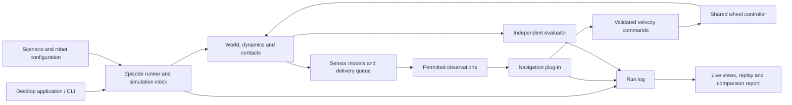

# Simulated Universe: integration and navigation evaluation plan

Draft for team review. Based on repository revision `20becff`, inspected on September 23, 2026. This document proposes a design; the package, interfaces, and commands shown below are not implemented yet.

## 1. Intended outcome

Build one **AutoNav Universe** application where a teammate can register a navigation algorithm, select a scenario, run it interactively or in a batch, and receive a reproducible evaluation report. Adding an algorithm should require an adapter and configuration, with no edits to simulator internals.

Use a shared Python simulation engine for the first release, extracting useful code from the existing simulators. Put both the graphical application and benchmark command behind the same engine. Add a ROS 2 adapter and a Gazebo backend in a subsequent release after confirming compatibility with the actual robot workspace.

The first useful end-to-end demonstration is a robot navigating GPS waypoints through obstacles and ramps using simulated odometry, GPS, and LiDAR, with the existing recovery logic and wheel controller available as baseline components. Every displayed sensor, robot motion, and score must come from that same run.

## 2. What we can reuse, and what must change

| Existing component | Reuse | Integration work |
|---|---|---|
| [GPS simulator](GPS_Sim/simulated_world/gps_sim_gui.py) | `GPSEKF`, GPS interference models, scenario generation, odom-frame goal projection, recorded field cases | Split `GPSWaypointSim.step()` into sensor, algorithm, dynamics, and scoring responsibilities. Complete the truth/belief separation, including cold-start paths. |
| [LiDAR simulator](LiDAR_Sim/simulated_world/lidar_sim_gui.py) | `gen_rays`, `do_scan`, PCA grade processing, costmap accumulation, A* and smoothing, STL terrain | Separate ray casting from perception; change the perception boundary to sensor-local point clouds. Remove GUI and module-global configuration dependencies. |
| [Behavior Tree simulator](BEHAVIOR_TREE_Sim/simulated_world/bt_sim_gui.py) | `Sim.build`, robot dynamics, maze/track generation, recovery states, planner and headless/scatter workflows | Split `Sim.step()`; replace the baseline controller's direct reads of true robot pose with permitted observations/estimates. |
| [SPEED simulator](SPEED_Sim/simulated_world/speed_sim.py) | `WheelPID`, per-wheel dynamics, speed tracking diagnostics | Share one chassis/controller configuration with BT; reconcile force limits and units instead of inheriting conflicting defaults. |
| [GUI simulator](GUI_Sim/simulated_world/runner.py) | HUD presentation, message conversion, recording/playback components | Replace independent synthetic/replayed sensor streams with messages from the shared run. Keep `fake_ros` confined to the HUD compatibility adapter. |
| [Mock course](Mock_Course_Asset/README.md) | `Course.blend` as the course-authoring source | Build and validate geometry/metadata export. This checkout has no complete SDF world, robot model, or ROS/Gazebo launch pipeline. |
| `LiDAR_Lines_Sim` | `Data/Floor.blend` asset | Treat as a future scenario asset; this checkout contains no line-perception simulator implementation. |

The current programs are subsystem experiments, not interchangeable backends. GPS runs at a different simulation rate from BT/SPEED; LiDAR navigation also uses different motion assumptions. Their current success rates must not be compared as if they came from the same environment.

Resolve these known baseline blockers during extraction:

- GPS's current obstacle costmap is built from scenario geometry. Keep it private to the world, or explicitly label an oracle-map diagnostic; the reference navigation costmap must instead come from permitted sensors.
- The LiDAR threshold-sweep wrapper calls a benchmark entry point that reparses arguments and resets the effective threshold to its default. Replace nested command-line parsing/global mutation with a typed run configuration, and report the effective threshold with every result.
- Existing ramp verdicts allow some lethal-cell samples and can accept a blocked ramp without arrival. Replace those verdicts with explicit traversal, safety, and mission assertions before using them as release evidence.

## 3. Architecture and ownership



Assign each responsibility one owner:

- **Engine:** clock, world geometry, robot state, physics, contacts, sensor sampling, and episode lifecycle.
- **Algorithm:** perception, localization, goal projection, planning, and recovery, to the extent included in the selected evaluation track.
- **Controller:** converts commanded forward speed and yaw rate into wheel targets and forces. It never teleports the robot along a planned path.
- **Evaluator:** reads private truth and decides mission success, failures, and metrics. An algorithm's own “arrived” flag is diagnostic only.
- **Application:** configuration, start/pause/reset, visualization, replay, and comparison. Rendering does not advance simulation time.

Proposed package layout:

```text
pyproject.toml
src/autonav_universe/
  api/            # Versioned observations, actions and plug-in protocols
  core/           # Clock, scheduler, runner and private world state
  dynamics/       # Shared robot model and wheel control
  sensors/        # LiDAR, GPS, odometry and fault models
  algorithms/     # Baseline navigation and reusable components
  scenarios/      # Configuration validation and asset loading
  evaluation/     # Outcomes, metrics, suites and reports
  recording/      # Events, sensor records and replay
  adapters/       # HUD compatibility; later ROS and Gazebo
  ui/             # Experiment setup and live/replay views
  cli.py
scenarios/
benchmarks/
examples/my_navigation/
tests/
```

Keep the existing launchers working during extraction. Move shared logic into the package and let legacy programs call it incrementally. Use one supported installation with optional GUI, recording, and ROS dependencies; the headless engine must import and run without loading a windowing toolkit. Reuse the existing Qt tooling for the application, after removing import-time GUI behavior from the core.

## 4. The algorithm interface

### Primary contract: observations in, velocity commands out

The first release supports Python plug-ins loaded from an installed module, for example `my_navigation.policy:MyNavigator`. A supplied template and validation command make the adapter straightforward.

```python
from typing import Protocol

# Types below belong to the proposed autonav_universe.api package.
class NavigationAlgorithm(Protocol):
    def reset(self, context: EpisodeContext) -> None:
        """Initialize a new episode; discard all previous episode state."""

    def step(self, observation: Observation) -> NavigationCommand:
        """Consume available observations and return a command."""

    def close(self) -> None:
        """Release resources after success, failure, or cancellation."""
```

| Contract | Required meaning |
|---|---|
| `EpisodeContext` | API version, robot dimensions and command limits, permitted sensor capabilities, algorithm configuration/seed, and public mission goals. No world object, hidden fault zones, true spawn transform, or private scenario-generation seed. |
| `Observation` | Simulation time, elapsed time since the previous call, episode/sequence IDs, and permitted sensor samples available by this instant. Every sample carries acquisition time, delivery time, frame, validity, and uncertainty where applicable. |
| Sensor payloads | GPS latitude/longitude in degrees with fix validity/covariance; odometry in a spawn-relative frame with supported pose/twist fields; LiDAR XYZ in meters in the sensor frame. Missing or stale readings remain explicitly missing/stale. |
| `NavigationCommand` | Forward velocity `linear_mps`, yaw rate `angular_radps`, and command expiry in simulation time. Positive yaw is counterclockwise. Zero is a valid stop request. No pose-setting or world-mutation capability. |
| Optional diagnostics | Estimated pose, planned path, costmap, and recovery state, all tagged with frame and time. These go to logging/visualization, not the evaluator's truth source. |
| Plug-in manifest | Entry point, interface version, algorithm version, parameters, supported track, required sensors, requested update rate, and optional diagnostics. |

The runner rejects incompatible capabilities before launch. It validates finite command values, applies the same configured limits to all algorithms, and records both requested and applied commands. Expired commands apply a zero target; physical braking still follows the robot model. Invalid actions, exceptions, and hard timeouts produce explicit failure records and do not crash the remaining batch.

Observation payloads are immutable snapshots. Sensor callbacks and plug-ins cannot mutate shared engine arrays. For a differential-drive profile, convert commands to wheel linear-speed targets using `left = v - omega * track_width / 2` and `right = v + omega * track_width / 2`, then apply the shared wheel PID.

Run benchmark plug-ins in separate worker processes so a hung algorithm can be terminated and restarted. Serialize only the public contract across that boundary; never pass existing `Sim`, `Robot`, mesh, or truth-view objects. This supports fault containment and prevents accidental truth access; it is not a security sandbox for hostile code.

### Evaluation tracks

Support two clearly labeled tracks, with separate results:

1. **Complete navigation:** the plug-in receives raw simulated sensor observations and owns its estimation, perception, planning, and recovery.
2. **Planner/controller:** a fixed, versioned reference perception/localization pipeline supplies an estimated pose, observed costmap, and estimated goal. The plug-in replaces planning/control while those upstream components remain identical for every competitor.

Add narrower component interfaces later, following the same contracts: `localize(samples) -> estimate`, `perceive(cloud) -> local_costmap`, `plan(estimate, map, goal) -> path`, and `control(estimate, path) -> command`. The initial complete-navigation interface should remain usable without adopting every component interface.

Preserve a **GPS-only profile** that exposes only local position and GPS readings as specified in [GPS rules](GPS_Sim/RULES.md), plus the public GPS mission. Do not introduce a north-referenced heading, compass, LiDAR map, or true world transform into that profile. Broader sensor profiles must be named and compared separately.

### Coordinates and information boundaries

Use meters, seconds, radians, and meters/second internally. MPH is a display conversion. Use named latitude/longitude fields to avoid positional ordering mistakes.

- Private `world`: an ENU course frame used by physics and scoring.
- `odom`: fixed at episode spawn, with arbitrary initial heading; its transform to world is hidden from algorithms and must be estimated when needed.
- `base_link`: x forward, y left, z up; `lidar`: a declared fixed mounting transform relative to the body.
- Public missions: GPS coordinates by default, or explicitly frame-tagged local goals for a local-navigation track. Never silently substitute a true world-space goal for an estimated goal.

For LiDAR, perform mesh queries only inside the sensor/world model. Convert returns to the sensor frame before delivery. Grade PCA must use sensor-up as required by [LiDAR rules](LiDAR_Sim/RULES.md); do not provide a mesh-derived surface normal as privileged algorithm input. Costmap placement uses permitted odometry/estimated transforms. Unknown cells and absent returns remain distinguishable from observed free space.

Do not stamp hidden map boundaries into an algorithm's costmap. The evaluator may detect a physical course exit privately. Name grade units explicitly: `grade_percent = 100 * tan(slope_radians)`; a 15% grade threshold is not 15 degrees.

## 5. Shared simulation, scenarios, and timing

Extract the BT/SPEED chassis dynamics and SPEED wheel PID into one configurable robot model. Reconcile their parameters first, then calibrate with existing speed traces and GPS field recordings. For the Python backend, use planar motion with terrain-derived height and tilt for sensor mounting, and explicit footprint contacts. Document limitations for ramp traction, suspension, and tipping; these require validation or a higher-fidelity backend before drawing hardware conclusions.

Start with these configurable rates:

| Function | Proposed initial rate |
|---|---:|
| Dynamics | Maximum integration step of 1/240 second, based on BT/SPEED |
| Wheel controller | 50 Hz, based on SPEED |
| Navigation calls | 20 Hz by default, declared in the benchmark profile |
| LiDAR | 20 Hz, matching the existing ramp benchmark setting |
| GPS / odometry | Explicit per-profile rates; preserve legacy rates in regression fixtures |
| Display | 30–60 Hz, independent of simulation time |

Use a scheduler with explicit event deadlines and deterministic ordering. Advance dynamics up to the next deadline, sample sensors, deliver due samples, call the algorithm if scheduled, validate its command, update wheel control if due, and record events. New commands affect subsequent integration. Do not approximate 50 Hz by rounding it to a number of 240 Hz steps; use exact event times and shorter final substeps.

Distinguish **functional mode**, where simulation waits for each algorithm result and records computation time, from **deadline mode**, where a declared budget controls late-action rejection and command expiry. Deadline mode uses a declared wall-to-simulation-time pace; the engine continues under the last valid command while the worker computes, then stops commanding motion at expiry. Tag responses with episode/observation IDs and discard late or superseded responses. Identify both modes in reports. Use bounded worker timeouts even in functional mode, and avoid mixing the two modes in rankings. Sensor/plan failures must not silently skip elapsed simulation time.

Each scenario configuration specifies:

- Geometry/asset version, units, ENU origin, robot profile, spawn, and ordered mission goals.
- Sensor rates, ranges, noise, latency, dropout, and GPS interference regions.
- Terrain/surface properties, obstacles, and allowed traversability thresholds.
- Maximum simulation duration, arrival rule, contact policy, and expected outcome.
- Seed policy and which capabilities the algorithm can observe.

Generate stable, independent random streams for world layout, each sensor/fault model, and the algorithm. Tie sampling to simulation time, not rendering or the algorithm's random-number consumption. Reusing a seed reproduces the environment and noise process; different trajectories will naturally produce different observations.

Validate spawn and goal placement against geometry and the profile's placement rules before starting. Apply the GPS interference-zone exclusions and LiDAR spawn-costmap validation where required by their existing rules. Reject invalid placements with an explanation; do not silently move them or fall back to unsafe coordinates.

Build a Blender export/validation step that produces runtime meshes plus a versioned metadata file. Verify units, origin, transforms, waypoint locations, ramp grades, collision shapes, and interference-zone properties. Prototype on the existing LiDAR STL and generated BT track first; add the full mock course after the export is validated. Treat documented Blender properties as something to inspect, not an already verified schema.

## 6. Team workflow and application

The desktop application should provide: algorithm selection, scenario selection, parameters/seed, Run/Pause/Reset, a live course view, sensor/estimated-map views, and a results comparison page. Truth overlays must be labeled and available only to the viewer/evaluator. A live HUD panel consumes this same run; unavailable camera or electrical data should be shown as unavailable rather than presented as measured data.

Proposed team workflow:

1. Copy the plug-in example or write a small wrapper around existing algorithm code.
2. Register its entry point and parameters in a configuration file.
3. Validate the contract and run one visual scenario.
4. Run the same algorithm against a frozen suite and seed list.
5. Compare its report with the reference algorithm and replay failures.

Illustrative commands, to be implemented:

```text
autonav-universe validate-plugin --algorithm my_navigation.policy:MyNavigator
autonav-universe run --algorithm my_navigation.policy:MyNavigator --scenario mock-course --seed 7 --gui
autonav-universe benchmark --algorithm my_navigation.policy:MyNavigator --suite navigation-v1 --output runs/candidate
autonav-universe compare runs/baseline runs/candidate
autonav-universe replay runs/candidate/<episode-id>
```

For an existing ROS navigation package, the later adapter publishes the same permitted sensor data, simulation clock, and permitted frame transforms, and consumes the deployed command interface. Verify topic names, message types, QoS, transform ownership, and command units against the main robot repository before freezing this mapping; that workspace was not present for this review. Reset must also reset the ROS algorithm state between episodes.

Keep the ROS adapter separate from the optional Gazebo backend: ROS algorithms can first run against the Python engine. Pin and validate the actual ROS/Gazebo combination in a dedicated supported environment. Do not require the current desktop Python workflow to install the entire robot stack.

## 7. Evaluation that the team can trust

### Initial benchmark suite

| Family | Cases and purpose |
|---|---|
| Basic navigation | Straight route, turns, goal behind the robot, multiple waypoints, and an unreachable goal |
| Obstacle navigation | BT corridor/maze, narrow passages, blocked routes, and recovery traps |
| GPS resilience | Cold start, heading ambiguity, blackout, bias, spoofing, multipath, reconnect, and odometry drift; derive cases from [stall scenarios](GPS_Sim/STALL_SCENARIOS.md) |
| Terrain perception | Existing ramps at 15%, 20%, and 30% grade tolerance, ascent/descent transitions, walls, and missing returns at edges |
| Motion/control | Speed changes, braking, reversal, saturation, and modeled slip/disturbance cases |
| Combined mission | Mock course with ramps, obstacles, GPS outages, and an ordered waypoint mission |
| Interface resilience | Stale/missing sensors, invalid commands, plug-in exception, hang, reset, and version mismatch |

Separate tuning scenarios from the frozen evaluation suite. Run paired comparisons on identical scenario/seed lists and robot/sensor settings, initially proposing 30 seeds per stochastic family and all fixed regression cases. Record the actual number of runs and uncertainty; passing a finite suite does not prove universal reliability. Each navigation comparison gets an independent world, not competing robots in a shared scene.

### Outcomes and metrics

Define outcomes centrally: `success`, `collision`, `unsafe_terrain`, `timeout`, `out_of_bounds`, `invalid_action`, `algorithm_error`, `algorithm_timeout`, and `invalid_scenario`. Unreachable-goal and total-sensor-outage cases have their own expected safe outcome and are not counted as successful arrivals. Reject invalid scenarios before comparison, and show their counts instead of silently excluding them. Manual cancellation is separately recorded. Settle simultaneous events consistently: collision, forbidden terrain traversal, or a course exit on the goal-reaching step prevents a clean success.

- **Mission completion:** all required waypoints satisfied in order within the time limit. For the GPS competition profile, calculate at least 50% of the actual robot footprint inside the 1 m goal circle using private truth. Keep center-to-goal distance as a separate metric; it is not an equivalent criterion. Put any dwell-time requirement in the scenario.
- **Safety:** contact count, first-contact time, minimum clearance, out-of-bounds events, and forbidden terrain traversal. Record contacts before collision correction pushes the robot out. Default navigation suites terminate on the first contact; other contact policies get separate labels.
- **Efficiency:** completion time, traveled distance, goal error, and path efficiency against a declared feasible reference route. Report successful-run efficiency alongside failure rate to avoid rewarding algorithms that finish only easy cases.
- **Robustness:** outcomes by fault type, recovery count/time, GPS outage duration survived, and heading/position estimation error where the algorithm reports an estimate.
- **Control:** velocity tracking error, command saturation, and oscillation measures with published definitions.
- **Computation:** per-stage and end-to-end wall time, p50/p95/maximum, overruns, and real-time factor on a recorded machine/software configuration.

The LiDAR contract requires every cloud-to-costmap calculation to finish within **60 ms**; apply this gate to the reference perception pipeline and instrumented perception components. Report every violation and the maximum, not only an average. A complete-navigation plug-in may have no costmap stage; enforce its declared observation-to-command budget and mark cloud-to-costmap timing as unavailable unless explicitly instrumented. Do not infer that stage's compliance from total `step()` time. A 20 Hz stream has a 50 ms period, so sustained throughput and queue growth must also be tested. Bound the queue and record any dropped frames; a 60 ms result alone does not establish 20 Hz throughput. Run performance tests without competing benchmark workers.

For the ramp suite, test **classification/traversal** separately from **arrival**. A robot reaching a goal by detouring around a forbidden ramp must not count as crossing it. Test full traversal of allowed ramps in both directions using entry/exit gates, refusal of forbidden ramps, transitions to flat ground, and balanced assigned coverage across ramps. Require safe arrival through a bypass when that is the assigned mission. Reconcile stale benchmark comments/default expectations with the rules before declaring a baseline pass. Preserve the written 100% pass requirement for the specified deterministic terrain regression cases, without presenting it as a guarantee over all possible runs.

For the reference perception/component track, also assert that permitted ramps are not assigned high cost, ramp exits remain traversable, and no artificial lethal border is introduced. For opaque complete-navigation plug-ins, report these internal properties as unobserved and judge observable traversal/safety separately.

Do not let legacy predicted-failure flags end the new benchmark early: the GPS stall notes contain cases that recover with a longer budget. Keep such predictions as diagnostics unless termination is explicitly part of the benchmark definition.

### Saved outputs

Each run saves a manifest, per-episode metrics, event/command log, and replay data. The manifest includes simulator commit and dirty-change fingerprint, plug-in version/hash, API/track version, dependency lock, complete resolved configuration, asset hashes, seed list, timing mode, and hardware/runtime information. Keep private truth logs separate from plug-in observations.

Produce JSON for automation, CSV for team analysis, and a human-readable comparison report. Provide lightweight logs for all runs and sensor-rich records for selected/failing runs. Visual replay uses recorded state; deterministic rerun executes the algorithm again. Label those operations separately and state numerical tolerance when comparing reruns across platforms/backends.

## 8. Delivery sequence and acceptance gates

Suggested ownership below describes roles, not an assumption about the team's headcount. Assign names and estimate calendar dates after the first milestone reveals the extraction work.

| Milestone | Deliverable | Acceptance gate | Suggested owner |
|---|---|---|---|
| 0. Freeze contracts and evidence | API/schema draft, frames/units, benchmark definitions, captured legacy cases, dependency/asset audit | GPS/LiDAR rules mapped to checks; known truth access and inconsistent defaults listed; reproducible baseline records distinguish current bugs from intended behavior | Integration lead + algorithm/evaluation owners |
| 1. Thin end-to-end slice | Headless runner, one world/clock, shared robot + wheel PID, odometry, plug-in worker, one local-goal scenario and metrics | Two independently implemented plug-ins can be swapped by configuration; stop/reset/error/timeout work; no GUI dependency | Engine + API owners |
| 2. Integrate navigation components | GPS faults, LiDAR terrain sensor, reference estimator/costmap, GPS goal projection, planner/recovery baseline | One robot's commands drive all sensor observations; truth boundary checks pass; GPS outage and ramp regression cases meet explicit expectations | Sensor + algorithm owners |
| 3. Make evaluation repeatable | Frozen suites, paired seed runner, reports, logs and replay | Identical pinned reruns agree within declared tolerance; failures and runtime overruns remain visible; reference and candidate compare without core edits | Evaluation owner |
| 4. Deliver the unified desktop program | Scenario/algorithm controls, shared live views/HUD, validated course export, installer/setup guide and example plug-in | Fresh installation can run a combined course mission, compare two algorithms, and replay a failure using the documented workflow | Application + course owners |
| 5. Connect deployed software | ROS adapter, verified topic/frame contract, optional Gazebo backend | Actual robot navigation package runs against simulation; resets and clock handling work; backend-specific fidelity tests pass | ROS/robot-stack owner |

Milestone 1 is the first demonstration; milestones 1–4 constitute the proposed Python evaluation release. Milestone 5 adds robot-stack compatibility and higher-fidelity validation. API/evaluation fixtures and asset auditing can proceed in parallel after milestone 0; the UI can develop against recorded run snapshots once the event schema is stable.

Use targeted tests for frame/units conversion, command expiry, sensor timing, reset isolation, collision-before-correction reporting, goal-footprint overlap, and forbidden truth access. Compare extracted components against captured legacy inputs before changing their behavior. Then run combined end-to-end scenarios; pure extraction parity alone is insufficient where the legacy implementation violates a stated rule.

The first release is complete when a teammate unfamiliar with the simulator can install it, connect their code through the documented interface, run the common benchmark, inspect why an episode failed, and reproduce another teammate's result without modifying simulator source.

## 9. Decisions to confirm during milestone 0

Proceed with Python plug-ins and the shared Python backend as the working default. Confirm the team's deployment needs before freezing these remaining details:

- Target desktop operating systems and the exact robot ROS/Gazebo environment.
- Authoritative chassis dimensions, mass, force limits, braking, sensor mounts, and rates.
- Required initial track: complete navigation, planner/controller, or both.
- Goal-footprint geometry, contact/termination policy, computation reference machine, and evaluation time limits.
- Which Blender properties are actually present and which must be standardized for the mock course.

These decisions constrain fidelity and scoring. They need not delay the thin end-to-end prototype, provided its provisional values are visible in versioned configuration.
