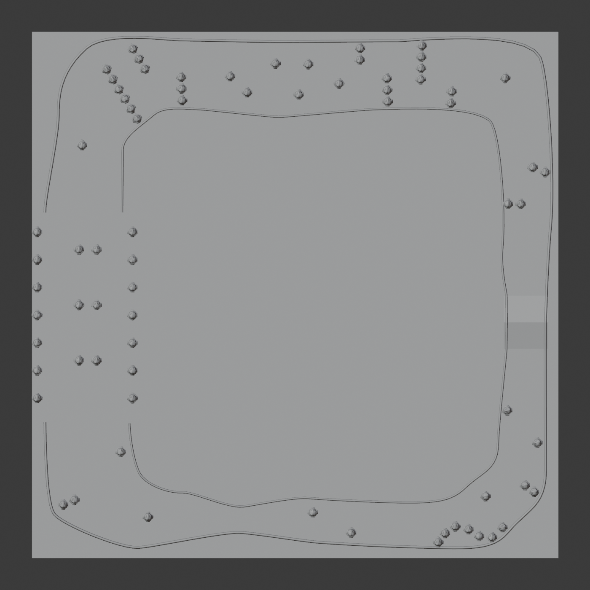

# AutoNav-Simulated-Universe

Simulation and evaluation tools for AutoNav robot navigation. This repository
contains a shared Python navigation engine, a pinned ROS 2 Humble / Gazebo
Fortress integration, standalone subsystem simulators, and the Blender source
for the local mock course.

## Current status

The shared Python package is **version 0.1.0**. The ROS/Gazebo integration has
completed one autonomous run of the full local diagnostic course. The latest
recorded pass is **October 7, 2026**, attempt `full-track-fix-20261007-76`:

| Check | Recorded result |
|---|---|
| Ordered waypoints | 5/5 reached |
| Finish | Reached after all waypoints |
| Referee violations | Zero |
| Speed requirement | Passed |
| Stop gate | Five consecutive zero velocity commands |
| Distance / simulation time | 165.042 m / 378.0 s |
| Maximum speed | 0.5 m/s |

This establishes one local-course diagnostic pass. Release acceptance still
requires repeated runs, a complete course and referee, sensor fidelity checks,
and a full-course control application. See
[implementation status](FULL_TRACK_IMPLEMENTATION_STATUS.md) for the evidence,
earlier attempts, and open gates. Recorded validation in the pinned Linux
container passed 32 Python tests and 30 ROS regression groups.

## Choose a workflow

| Workflow | Use it for | Guide |
|---|---|---|
| Shared Python engine | Develop navigation plugins, run authored scenarios, compare algorithms, and replay episodes without ROS | [Universe guide](UNIVERSE_README.md) |
| ROS 2 / Gazebo Fortress | Exercise the actual robot navigation stack against the exported local course | [Integration guide](integrations/ros_humble_fortress/README.md) |
| Standalone simulators | Work on GPS, LiDAR, recovery behavior, wheel control, or the robot HUD independently | [Simulator commands](SIMULATOR_COMMANDS.md) |

The Python engine and ROS/Gazebo integration are separate execution paths.
The Python viewer runs the authored Python scenarios; it does not launch the
Blender course or control the ROS/Gazebo diagnostic.

## Quick start: shared Python engine

Run these commands from the repository root. The shared engine requires
Python 3.10 or later; Python 3.12 is recommended when also using the standalone
simulators. The headless engine has no third-party runtime dependencies. The
optional GUI uses PyQt5.

### Windows PowerShell

```powershell
if (-not (Test-Path .\.venv\Scripts\python.exe)) {
    python -m venv .venv
}
.\.venv\Scripts\python.exe -m pip install -e ".[gui]"
.\.venv\Scripts\autonav-universe.exe validate-plugin --algorithm examples.my_navigation.policy:MyNavigator
.\.venv\Scripts\autonav-universe.exe run --scenario straight --seed 1 --output runs/example
.\.venv\Scripts\autonav-universe.exe app
```

### macOS / Linux

```bash
if [ ! -x .venv/bin/python ]; then
    python3 -m venv .venv
fi
./.venv/bin/python -m pip install -e '.[gui]'
./.venv/bin/autonav-universe validate-plugin --algorithm examples.my_navigation.policy:MyNavigator
./.venv/bin/autonav-universe run --scenario straight --seed 1 --output runs/example
./.venv/bin/autonav-universe app
```

For headless use, omit `[gui]` from the matching environment's install command
and omit `app`. `run` uses
`autonav_universe.algorithms:ReferenceNavigator` by default; select your own
implementation with `--algorithm module:Class`. The example plugin is in
[policy.py](examples/my_navigation/policy.py).

The Qt application offers Run, Pause, Reset, scenario, algorithm, and seed
controls. `run --gui` opens recorded replay after an episode. Algorithms
receive public observations and return velocity commands; the runner owns the
robot dynamics, sensor timing, private scoring, and truth replay. See the
[plugin contract and fidelity notes](UNIVERSE_README.md) before interpreting
benchmark results.

### Windows environment troubleshooting

Use `.\.venv\Scripts\python.exe -m pip` when launching the app from `.venv`.
A bare `pip` command may install into a different Python environment.

If `.venv` was recreated with a different Python version, old compiled Qt
components can remain installed for the previous version. Reinstall the GUI
dependencies with the environment's own interpreter:

```powershell
.\.venv\Scripts\python.exe -m pip install --force-reinstall -e ".[gui]"
.\.venv\Scripts\autonav-universe.exe app
```

### Benchmarks and replay

```powershell
.\.venv\Scripts\autonav-universe.exe benchmark --algorithm autonav_universe.algorithms:ReferenceNavigator --suite navigation-v1 --output runs/reference
.\.venv\Scripts\autonav-universe.exe benchmark --algorithm examples.my_navigation.policy:MyNavigator --suite navigation-v1 --output runs/candidate
.\.venv\Scripts\autonav-universe.exe compare runs/reference runs/candidate
.\.venv\Scripts\autonav-universe.exe replay runs/candidate/straight-1 --gui
```

On macOS/Linux, use `./.venv/bin/autonav-universe` for the same commands.

| Prototype suite | Scope | Matching built-in algorithm |
|---|---|---|
| `navigation-v1` | Six authored layouts: straight, turns, obstacle, permitted ramp, forbidden ramp, and combined | `ReferenceNavigator` |
| `gps-prototype` | GPS turn bootstrap, blackout, bias, and odometry drift | `GPSFollower` |
| `gps-lidar-prototype` | Ordered GPS goals with LiDAR, an obstacle, a ramp, and GPS blackout | `GPSLidarNavigator` |
| `planner-controller-prototype` | Six layouts with a fixed sensor-derived pose and costmap | `FixedPipelinePlanner` |

All four suites use seeds 1, 2, and 3 by default. Built-in algorithm entry
points use the prefix `autonav_universe.algorithms:`. These suites are still
prototypes; they are not the frozen release benchmarks in the integration plan.
Compare runs from matching suites and timing configurations. A failed episode
produces a nonzero benchmark exit code while retaining its results.

Runs save configuration manifests, episode metrics, events, and truth replay;
benchmarks also save CSV and Markdown summaries. `run --rich` records the full
public observations. The Python backend uses simplified planar dynamics and a
height field; it has no suspension, traction loss, tipping, or contact impulses.
Its scenarios do not contain the full Blender course geometry.

## ROS 2 Humble / Gazebo Fortress

The integration builds pinned simulator, robot, and Nav2 sources in a Docker
volume. It includes local wheel/gyro and global GPS localization, LiDAR-derived
mapping, footprint-aware planning and control, readiness checks, supervised
velocity commands, and course scoring. Navigation uses simulation time; the
stop gate uses a steady clock.

On Windows, start Docker Desktop's Linux engine before setup. The current run
launcher requests `--gpus all`, so the Docker runtime must support GPU access.
Download the LFS assets and build the workspace:

```powershell
git lfs install
git lfs pull
.\integrations\ros_humble_fortress\setup.cmd
```

Choose the diagnostic after setup:

```powershell
# Bounded compact-course diagnostic
.\integrations\ros_humble_fortress\run_compact_smoke.cmd 90

# Full local course: first generate the course/world bundle using the asset guide
.\integrations\ros_humble_fortress\run_full_track.cmd 900
```

The full-course launcher requires the matching generated `course.yaml`,
`world.sdf`, and manifest under `runs/full-track-diagnostic/`. Follow the
[course export instructions](Mock_Course_Asset/README.md) to create that bundle;
it is not included in a fresh clone. The launcher verifies source/course/world
hashes and waits for ROS readiness before dispatching the mission.

The Windows launcher opens a live browser course view and saves an offline
`replay.html`. Full runs also save a rosbag, result JSON, score, logs, and exact
input/build manifests in a fresh `runs/full-track-*` directory. Gazebo runs in
server-only mode. Mission completion and the stopping gate are reported
separately: a passed stop check alone does not establish a successful mission.

The October 7 pass belongs to the full local course. The compact-course
diagnostic has separate navigation failures and is not covered by that pass.
The [integration guide](integrations/ros_humble_fortress/README.md) documents
launcher options, container validation, and the navigation corrections.

## Standalone subsystem simulators

Each simulator keeps its own dependencies and virtual environment under
`<Sim>/simulated_world/`. Use Python 3.12 and install its `requirements.txt`;
the root shared-engine environment does not replace these environments.
[SIMULATOR_COMMANDS.md](SIMULATOR_COMMANDS.md) contains the complete Windows
setup, scenario flags, direct entry points, and benchmark commands.

| Simulator | What it exercises | Windows entry after setup |
|---|---|---|
| [LiDAR](LiDAR_Sim/RULES.md) | STL terrain, simulated point clouds, grade-based costmaps, and ramp crossings | `.\LiDAR_Sim\Run_LIDAR_SIM_direct.bat --threshold 20 --rays 2000` |
| [GPS](GPS_Sim/RULES.md) | GPS/odometry heading estimation without a magnetometer, waypoint missions, and interference | `.\GPS_Sim\Run_GPS_SIM_direct.bat --real --single --seed 7` |
| Behavior tree | Corridor/maze navigation and recovery transitions on Chaplygin sleigh dynamics | `.\BEHAVIOR_TREE_Sim\Run_BT_SIM_direct.bat --layout track --seed 7` |
| Speed control | Per-wheel PID tuning with a 0–5 MPH setpoint | `.\SPEED_Sim\simulated_world\.venv\Scripts\python.exe .\SPEED_Sim\simulated_world\speed_sim.py` |
| GUI/HUD | The robot HUD against synthetic ROS sensor topics | `.\GUI_Sim\Run_GUI.bat` |

The folders also provide macOS `.command` launchers. SPEED has a macOS launcher
and can be run directly through Python on Windows. The HUD simulator's
`Bake_Bag_Video` launchers render playback CSV or rosbag2 recordings to MP4.

For the standalone LiDAR GUI, click to place a robot, Shift-click to place a
goal, and press `G` to navigate. On macOS, the configuration launcher may
auto-start with default options; use `Run_LIDAR_SIM_direct.command` to pass
flags directly. A missing `Consolas` font on macOS/Linux falls back to the
system monospace font.

## Local course asset and release work

[Course.blend](Mock_Course_Asset/Course.blend) is the source for the local
diagnostic course. The audited scene contains 83 objects: a 38 × 38 m ground,
two line meshes, one ramp, 73 cones, a start marker, and five waypoint markers.
The export tools preserve object metadata and generate a paired course/world
bundle using the pinned upstream simulator. The SDF is generated from semantic
YAML rather than every Blender collision mesh.



The course still needs authored potholes, No Man's Land, an internal boundary,
an explicit finish gate, and ordered referee checkpoints. Waypoint/finish roles
are provisional, and the ground exceeds the reference footprint.
`--require-complete-assets` currently rejects the asset. The
[asset manifest](Mock_Course_Asset/course_asset_manifest.json) records the gaps.

Remaining release work includes:

- Three clean repeat runs, ten-seed evaluation, a rules-complete referee, and
  performance acceptance.
- Verified ramp contact and camera-visible marking geometry, hardware sensor
  calibration, camera line/pothole perception, and lane-to-GPS transitions. The
  current x86 container skips the upstream CUDA camera detector.
- A full ROS/Gazebo Run/Pause/Resume/Stop/Reset application and a verified reset
  lifecycle. The Python Qt controls belong to the separate Python backend.
- Full terrain/waypoint suites, legacy component parity checks, and a polished
  Python comparison view.

## Repository map and validation

```text
src/autonav_universe/          Shared Python engine, API, algorithms, CLI, viewer
examples/my_navigation/       Navigation plugin example
scenarios/                    Authored Python scenarios
benchmarks/                   Prototype suites and seed lists
integrations/                 Pinned ROS/Gazebo setup, profiles, and source patches
Mock_Course_Asset/            Blender source, metadata, semantics, and overview
tools/                        Course export, audit, and preparation tools
tests/                        Python checks and ROS/native regression groups
LiDAR_Sim/ GPS_Sim/           Standalone perception and GPS simulators
BEHAVIOR_TREE_Sim/ SPEED_Sim/  Standalone recovery and wheel-control simulators
GUI_Sim/                     Standalone robot HUD simulator
runs/                        Generated results, exports, logs, replays, and bags
```

After installing the shared package, run the Python checks from the repository
root:

```powershell
.\.venv\Scripts\python.exe -m unittest discover -s tests -v
```

On macOS/Linux, use `./.venv/bin/python`. One launcher lifecycle check requires
Linux and is skipped on Windows. ROS/native checks require the pinned
container and built workspace; see the integration guide.

Virtual environments, `runs/`, build outputs, temporary files, Python caches,
and generated recordings are ignored by Git. Recorded attempt bundles are
local outputs; the implementation report preserves their observed outcomes.
The `.stl` and `.blend` assets are tracked with Git LFS.

Further reading: [Python integration plan](INTEGRATION_PLAN.md),
[full-track plan](FULL_TRACK_AUTONAV_PLAN.md),
[implementation status](FULL_TRACK_IMPLEMENTATION_STATUS.md), and the pinned
upstream [robot](https://github.com/KazakhStallion/AutoNav_25-26) and
[simulator](https://github.com/blobspire/autonav_sim) repositories.
