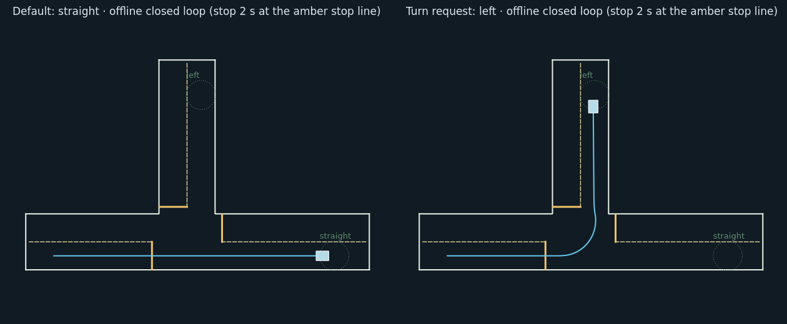

# Self-drive T-intersection: junction recognition and turn choice

The self-drive mode can now recognise a two-lane T-intersection in its live
cost maps, stop briefly at its stop line, and then go straight (default) or
turn left when asked. The layout follows the hand sketch of 2026-11-17: a
horizontal road with a branch leaving to the north. The robot starts
eastbound in the south lane.



Not to scale:

```
                     x=12.0   x=14.4   x=16.8
                        |        :        |
                        |  branch:        |
                        |========:        |   y=7.4  southbound stop line
   y=6.8 _______________|                 |________________
   y=4.4  - - - - - - - |                 ║ - - - - - - - -   x=17.4 westbound stop line
   y=3.2      robot →   ║                                     x=11.4 eastbound stop line
   y=2.0 __________________________________________________
       x=0.6                                            x=30
```

Each inbound lane has a crossable stop line 0.6 m before the junction box:
eastbound (the robot's), westbound and southbound. The sketch's extra line
across the outbound east lane is omitted because it would block the straight
route. The sketch's small circle is ignored.

## Running it

In the **Self-drive track** tab, choose **Track: T-intersection**, then
**Run ROS track**. **At junction** chooses *Straight (default)* or *Turn
left*. It can be changed while the robot drives; the choice is read when the
robot leaves the stop line. The run completes when the robot enters the
straight or left exit zone (evaluator-only zones from `track.json`).

The turn request also arrives over ROS as a standing value. The latest change
from either source wins:

```bash
# inside the self-drive container (ROS_DOMAIN_ID is in runs/<run>/desktop_session.json)
ros2 topic pub --once /self_drive/turn_command std_msgs/msg/String "{data: left}"
```

Values are `straight` or `left`, case-insensitive. Anything else is ignored
and reported in `/self_drive/status` as `junction.turn_command_note`. For a
container without the desktop app, `SELF_DRIVE_TRACK=intersection`,
`SELF_DRIVE_TURN_COMMAND=left` and `SELF_DRIVE_STOP_HOLD_S` (default 2.0)
configure the run.

## How the junction is recognised

`src/autonav_universe/intersection.py` reads only the observed grids that the
lane reference planner already uses: the combined local costmap, the
classified hard-tape grid (`/lidar_line_costmap`) and the classified
crossable paint grid (`/self_drive/divider_costmap`). It measures the
pattern in a road frame at `base_link` (along the observed lane direction).

| Signature | Measured as |
|---|---|
| Stop line | Crossable paint covering ≥ 50 % of the robot's own lane interior at one distance ahead. The dashed divider runs along the road and never covers the lane. |
| Side opening | One road width from the opposite edge, a ≥ 1.6 m run of observed, non-lethal cells where the edge tape should continue. Tape is dilated by 0.2 m so sparse LiDAR returns are not read as gaps. |
| Junction, not curve | The opposite edge must fit one straight line (slope ≤ 0.1, residual ≤ 0.12 m) from behind the robot across the opening. A road curving away also empties its inner edge, but then its outer edge bends too. |
| Straight on | No hard tape across ≥ 60 % of both lanes ahead. |

Edges are read from the hard-tape grid when it is available, so a tire beside
the lane is not taken for a road edge.

## What the robot does

`IntersectionManager` emits one directive per controller tick:

1. **cruise**: normal lane following. Two consecutive stop-line sightings
   switch to approach.
2. **approach**: the planner's path is cut at the stop pose, with the padded
   nose 0.25 m before the line, so MPPI slows to the path end.
3. **stopped**: zero velocity and enable revoked through the command gate
   for `SELF_DRIVE_STOP_HOLD_S` once at rest. Observation continues.
4. **commit**: the far road edge is often beyond the LiDAR line
   detector's reach, so a missing edge cannot confirm a branch. The left
   option is therefore `confirmed` (gap seen beyond the stop line), `blocked`
   (tape seen continuing where the branch would start) or `unknown`. A left
   request is taken unless the option is `blocked`; with `unknown` the branch
   is assumed to begin 0.6 m past the stop line and to be one road width
   wide (`route_note: requested_branch_unconfirmed`). Otherwise the robot
   goes straight if possible. If the turn path stays blocked for 5 s, it
   also goes straight (`left_turn_blocked`).
5. **crossing_straight**: the planner runs with the road direction locked
   until the junction is behind the robot.
   **crossing_left**: MPPI follows a fixed turn path. It runs straight, then a
   quarter arc (radius 3.0 m, falling back to 2.6, 3.4, 2.2 or 1.8 m), then
   straight into the branch's outbound (east) lane. The path is checked
   against the padded body every 0.2 m. If blocked, the robot holds
   (`left_turn_blocked`) and retries.
6. Lane-direction fits more than 0.6 rad (34°) from the current travel
   direction are rejected for every source. The first Gazebo run
   (2026-11-18) showed why: near the line the divider fit locked onto the
   stop line, and the planner pivoted the robot 80° on the spot. While
   approaching, the planner also uses the road direction locked at the stop
   line, never a fresh fit.
7. Lane centring (all self-drive, not only junctions): hard tape carries a
   clearance cost reaching about 1 m into the 2.4 m lane, and the crossable
   divider carries none, so the cheapest place is beside the divider. With
   no restoring term, MPPI's 2–3° tracking error drifted the robot onto the
   divider after the second Gazebo run's turn. The reference planner now
   charges the squared offset from the centre between observed tape and
   observed divider, capped at 0.5 m (`SELF_DRIVE_CENTERING_WEIGHT`, default
   1.5; 0 restores the old behaviour). In an offline check with a constant
   3° heading bias, a robot started 0.7 m off centre returned to within
   0.12 m. Without centring it stayed by the divider.
8. Control returns to observed lane guidance only once it agrees with the
   new road direction (within 0.12 rad for 3 ticks in a row), or after 4 m.
   A looser 0.3 rad check once handed back on a 16° fit and caused a wobble. Stop-line ends and
   corners cannot be fitted as a lane, so while at the junction the lane fit
   is seeded with the committed heading.

The route is decided only at a stop line. An opening without one is reported
in status but not acted on, so the closed loop track behaves as before.

`/self_drive/status` gains a `junction` object: `state`, `reason`,
`turn_request` and source, `route`, `route_note`, `options`, `stop_line_m`,
`left_opening_m`, `road_width_m`, `hold_remaining_s`. Controller states such
as `approaching_stop_line`, `stopped_at_stop_line` and `turning_left` appear
in the tab's status line.

## Validation and limits

* `tools/simulate_intersection.py` is an offline closed loop. It renders the
  local grids from the generated track with a 140° / 6 m field of view and
  memory, then runs the real guidance, junction manager and reference
  planner. A pure-pursuit tracker with drive lag stands in for MPPI.
  * Both routes stop with the physical nose 0.40–0.56 m before the line,
    hold 2.2 s and finish at their exit with no tape contact.
  * The same holds at 0.05 m resolution, with ±0.3 m start offsets, a 0.08
    rad start heading error, and a left request sent during the approach.
  * A loop lap reported no junction.
  * `tests/test_intersection.py` covers the pattern, the state machine and
    both closed-loop routes.
* The simulator's sensor matches the ROS line detector: tape and paint are
  marked only within ±54° and 4.5 m of the LiDAR, and paint hits are joined
  across gaps up to 0.8 m, like the divider node. This reproduced the
  Gazebo stop-line fit before the fix. Tests also cover a branch closed by
  tape: a left request then goes straight.
* `controller.log` records one line per state change: junction state,
  route, options, stop-line distance, guidance and pose.
* The ROS controller's `tick()` was exercised with stub ROS modules on the
  same simulated grids, through both the topic and the desktop control file.
* **Gazebo:** the first run (2026-11-18, left requested) pivoted at the
  stop line, as described above, and has not yet been repeated with the fix.
* The 8 m local window sees a gap of at least 1.6 m only within about 2 m of
  it. The left opening is therefore confirmed while stopped at the line, not
  earlier. Branch width is assumed equal to the measured road width unless
  the far corner is seen.
* Only straight and left are supported; a right turn is not implemented.
